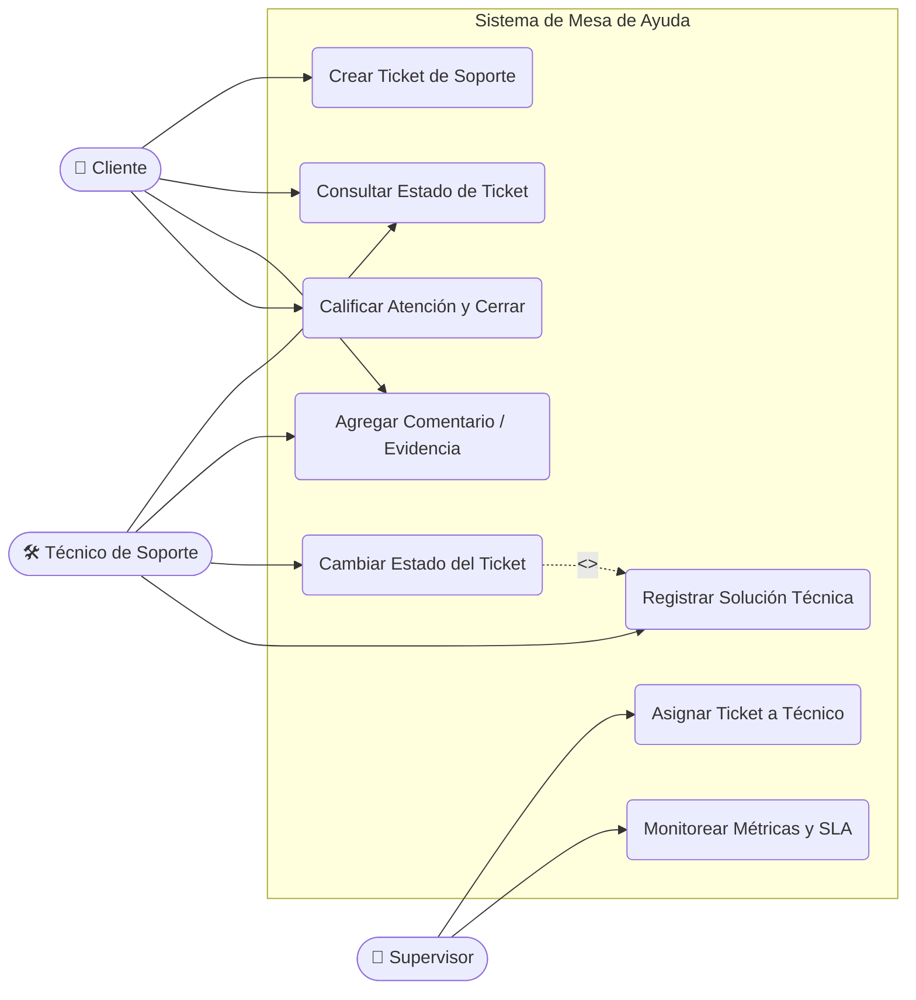
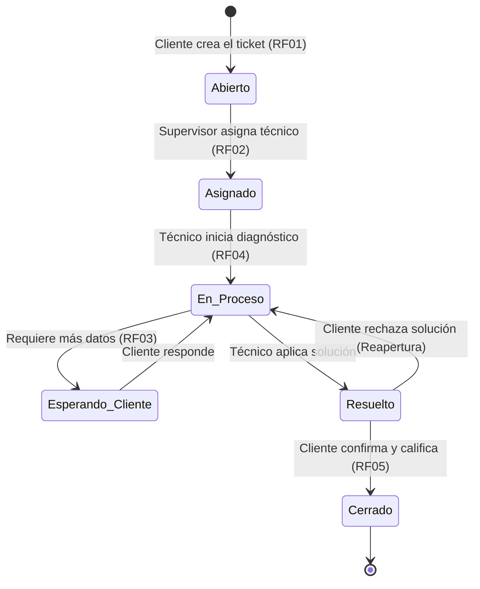
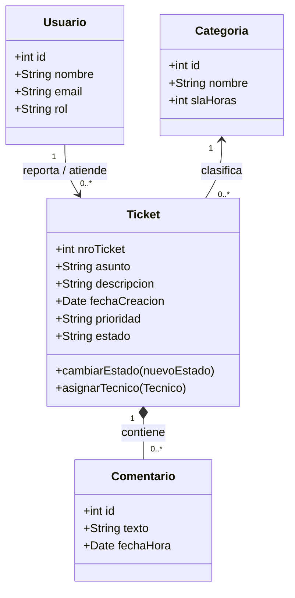

# 🛠️ Sistema de Mesa de Ayuda (Help Desk) - Análisis y Diseño

Este repositorio contiene el relevamiento de requisitos, casos de uso y modelado UML para un sistema de gestión de tickets de soporte técnico. El objetivo del proyecto es traducir las necesidades operativas de un área de soporte en especificaciones técnicas claras mediante diagramas como código (**Mermaid.js**).

---

## 📋 1. Relevamiento de Requisitos

### Requisitos Funcionales (RF)
* **RF01 - Creación de Tickets:** El usuario cliente debe poder registrar un nuevo incidente detallando asunto, descripción y nivel de urgencia.
* **RF02 - Asignación de Técnicos:** El supervisor o sistema debe poder asignar un ticket abierto a un técnico disponible según su especialidad.
* **RF03 - Seguimiento y Comentarios:** Tanto el cliente como el técnico pueden añadir comentarios o adjuntar capturas al historial del ticket.
* **RF04 - Cambio de Estado:** El técnico puede actualizar el estado del ticket (`Abierto`, `En Proceso`, `Resuelto`, `Cerrado`).
* **RF05 - Encuesta de Satisfacción:** Una vez resuelto el ticket, el cliente puede calificar la atención recibida para cerrar definitivamente el caso.

### Requisitos No Funcionales (RNF)
* **RNF01 - Usabilidad:** La interfaz de carga de tickets no debe requerir más de 3 pasos para el usuario final.
* **RNF02 - Tiempos de Respuesta (SLA):** El sistema debe emitir una alerta automática si un ticket de prioridad "Alta" pasa más de 2 horas sin ser asignado.
* **RNF03 - Trazabilidad:** Todo cambio de estado debe quedar registrado con fecha, hora y usuario responsable (Auditoría).

---

## 👥 2. Diagrama de Casos de Uso ( Flujo de Actores )

Representación de las interacciones principales entre los tres actores del sistema (**Cliente**, **Técnico de Soporte** y **Supervisor**) y los casos de uso identificados:

---

## 🔄 3. Ciclo de Vida del Ticket (Diagrama de Estados UML)

Modelado del comportamiento de un ticket desde que es reportado hasta su cierre definitivo:

---

## 🗂️ 4. Modelo de Dominio (Diagrama de Clases UML)

Estructura de las entidades principales para la futura base de datos y lógica de negocio:

---

## 📌 Especificación Detallada: Caso de Uso Principal (CU01)

| Campo | Descripción |
| :--- | :--- |
| **Nombre** | **CU01 - Crear Ticket de Soporte** |
| **Actor Principal** | Cliente (Usuario interno o externo) |
| **Precondiciones** | El usuario debe haber iniciado sesión en el portal de autogestión. |
| **Flujo Normal** | 1. El cliente selecciona "Nuevo Ticket". 2. El sistema muestra el formulario con Categoría, Prioridad, Asunto y Descripción. 3. El cliente completa los datos y envía el formulario. 4. El sistema valida los campos, asigna un número único, establece el estado en `Abierto` y notifica al área de soporte. |
| **Flujo Alternativo** | **3a. Datos incompletos:** El sistema resalta los campos obligatorios faltantes y solicita completarlos antes de guardar. |
| **Postcondiciones** | El ticket queda registrado en el sistema y pendiente de asignación en el panel de soporte. |